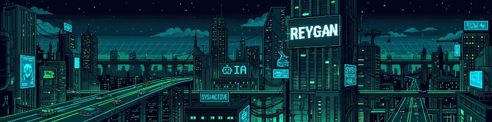

  <!-- BANNER PIXEL ART: CIUDAD CYBERPUNK -->
  

    

  <!-- ENCABEZADO PRINCIPAL -->
  <h2>👾 Hola, soy <code>reygan</code></h2>

  <!-- CONSOLA ANIMADA (TYPING SVG) -->
  

---

<!-- SECCIÓN SOBRE MÍ (TARJETA DE VIÑETAS) -->

  <h3><code>&gt;_ whoami</code></h3>
  <table>
    <tr>
      <td align="left">
        <code>🟢 SYS.ID:</code> <b>reygan13 // NETRUNNER_NODE</b>  
        🔹 🎓 Estudiante de <b>Ingeniería en Inteligencia Artificial</b>. 
        🔹 🧠 Apasionado por el mundo de la <b>IA</b>, modelos y automatización. 
        🔹 ⚙️ Enfocado en el desarrollo y arquitectura <b>Backend</b>. 
        🔹 🎮 Desarrollo interactivo y lógica de sistemas en motores de videojuegos.
      </td>
    </tr>
  </table>

---

<!-- SECCIÓN DE TECNOLOGÍAS (FORMATO CUADRÍCULA DE ICONOS) -->

  <h3>⚡ Tecnologías y Herramientas ⚡</h3>
   
  

    
  

  

    
  

---

<!-- ELEMENTOS 1 Y 2: ESTADÍSTICAS, RACHAS Y LENGUAJES MÁS USADOS -->

  <h3>📊 Métricas del Sistema</h3>
   

  <!-- Estadísticas Generales + Racha Actual -->
  

    
    
  

  <!-- Lenguajes Más Usados -->
  

    
  

---

<!-- ELEMENTO 5: WINS & ÁREAS DE ENFOQUE -->

  <h3>🏆 Wins & Enfoque de Desarrollo</h3>
   
  

    
    
  

  

    
  

  <!-- Plantilla lista para agregar futuros logros o repositorios específicos -->
  <!-- 
  

    
  

  -->

   
  <code>&gt;_ [ EOF // REYGAN13_CITY_NODE: ONLINE ]</code>

